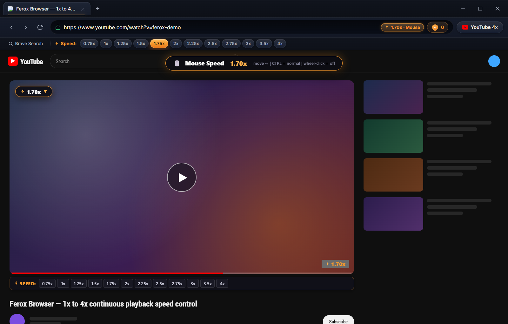
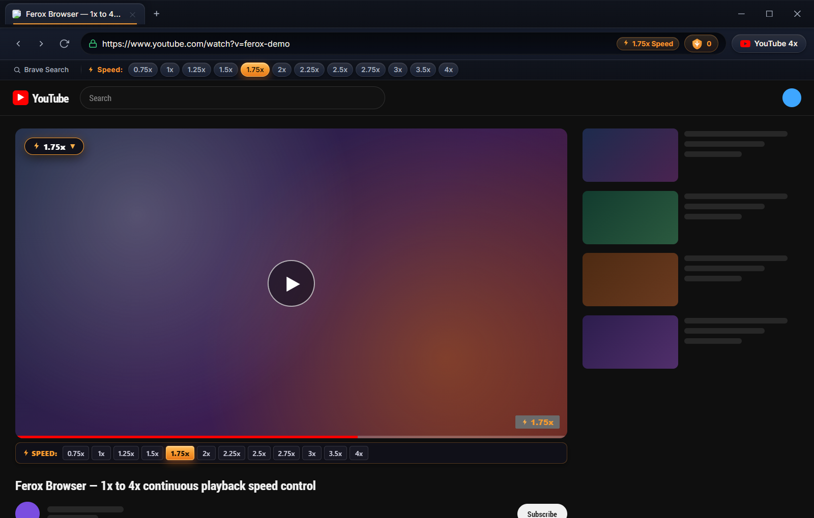

# 🦡 Ferox Browser

<p align="center">
  
</p>

> A privacy-first **Brave Browser fork** that runs Brave's **actual `adblock-rust` Shields engine** (the real Rust engine behind Brave's ad blocker, ~206k filter rules), a dedicated **single-tap 1x–4x playback speed toolbar**, brand-new **continuous mouse speed control** (lock on with a wheel-click and tune the speed by moving the mouse), and a matching **Android app** with a drag-and-hold speed bubble.


### 🔗 Downloads & Releases

* **💻 Windows Instant Portable**: [`Ferox.exe`](Ferox.exe) — extracts once on first run, then **opens instantly**; also available as [`Ferox.lnk`](Ferox.lnk) shortcut
* **📦 Windows Installer**: [`Ferox-Setup.exe`](https://github.com/XNtriCT/Ferox/releases/download/v1.2.0/Ferox-Setup.exe)
* **📱 Android APK (v1.2.0)**: [Download Ferox-Android-v1.2.0.apk](https://github.com/XNtriCT/Ferox/releases/download/v1.2.0/Ferox-Android-v1.2.0.apk)
* **🐙 GitHub Repository**: [https://github.com/XNtriCT/Ferox](https://github.com/XNtriCT/Ferox)

---

## 📸 Screenshots

### Speed toolbar + mouse speed control locked on at 1.70x
The wheel-click mouse speed control tunes the video continuously while the closest preset (`1.75x`) lights up as an approximate indicator.



### Single-tap speed toolbar with live active indicator
The 1x–4x speed bar sits directly below the URL bar. The active speed glows in the brand's warm orange gradient, both in the browser toolbar and inside the YouTube player.



> Screenshots are generated from the real app UI via [`scripts/screenshots/capture.js`](scripts/screenshots/capture.js) (a local mock video page is used for deterministic captures).

---

## ✨ Features

- **🖱️ Continuous Mouse Speed Control (New)**:
  - **Wheel-click (middle-click) to lock on / off** while a video is playing.
  - Move the mouse **right to speed up** and **left to slow down** across a fully continuous **1x → 4x** range — no fixed steps, up to 0.01x precision.
  - Only the playback rate changes — the playhead is never touched or seeked.
  - The nearest preset button in the toolbar lights up as an approximate indicator (e.g. `1.70x` → `1.75x`).
  - **Hold `Ctrl`** to temporarily use the mouse normally (open links in a new tab, click, scroll) without leaving the lock mode.
  - Mouse wheel **scrolling keeps working normally**; only the wheel *click* is reserved while locked.
- **⚡ Linear Single-Tap Speed Toolbar (0.75x to 4x)**:
  - Instant one-tap speed buttons located directly below the URL bar: `0.75x`, `1x`, `1.25x`, `1.5x`, `1.75x`, `2x`, `2.25x`, `2.5x`, `2.75x`, `3x`, `3.5x`, `4x`.
  - Live active indicator: the closest speed glows in brand orange (`#f79a2e`).
  - Extended keyboard shortcuts (`Shift + >` and `Shift + <`) scale smoothly up to **4x**.
  - Smooth audio pitch preservation (`preservesPitch = true`) keeping voices clear and natural.
  - Speed memory: remembers your preferred playback speed across sessions.
- **📱 Ferox for Android (v1.2.0)**:
  - Compact **speed selection bar on top**, directly below the URL space, matching the desktop web app.
  - Prominent **drag-and-hold speed bubble** (pulsing globule animation) docked between the *next* and *Brave Search* buttons.
  - Tap and hold the bubble, drag your finger anywhere on screen: **right = faster, left = slower**, fully continuous **1x → 4x**.
  - Release to deactivate and resume normal controls; the nearest top-bar preset lights up as the approximate indicator.
  - Full-screen live speed readout, haptic feedback, ad-skipping and background audio playback.
  - **Mini player & true fullscreen**: pressing back while a video plays shrinks it into a floating mini player — the feed stays exactly where you left it (no reload). Tap the mini player to expand, or use fullscreen video (auto-rotates to landscape) with hidden system bars and a vertical speed slider on the right edge that never covers the video.
  - **Background play**: audio keeps playing when you leave the app or lock the screen; the playback notification includes Pause/Play controls.
- **🦁 Real Brave Shields Engine (official `adblock-rust`)**:
  - Runs Brave's **own `adblock-rust` engine** (the npm binding Brave publishes) — the exact Rust engine that powers Brave Shields, not a look-alike.
  - Loads Brave's default filter catalog: **30 lists** (EasyList, EasyPrivacy, uBO assets, Brave-specific + cookie/annoyance lists) → **~206,000 rules**, compiled in seconds and cached for instant startup.
  - Three layers, like Brave: network request blocking, cosmetic CSS hiding, and scriptlet injection — plus Brave's resource library for `$redirect=` / `##+js()` rules.
  - YouTube pre-rolls and mid-rolls never start (player ad data is pruned before the player reads it); anything that still slips through is auto-skipped gracefully — playback is **never** fast-forwarded or seeked.
  - Live tracker & ad blocked counter in the Omnibox; bundled offline fallback filters so blocking never silently turns off.
  - Android ships the same list catalog through its own `shouldInterceptRequest` filter engine (~46k+ rules on device).
- **🌐 Modern Tactile UI**:
  - Brand-identity dark theme: hue-shifted orange gradients, rounded controls, inner catch-lights and layered ambient shadows — no flat or cartoonish colors.
  - Multi-tab management with framed tabs and fast keyboard navigation.
  - Omnibox with Brave Search integration.
  - Pop-ups requested by pages (middle-click / `target="_blank"`) open as **tabs in the same window**.

---

## 🖱️ How to Use Mouse Speed Control (Windows / Desktop)

1. Start playing any video.
2. **Click the mouse wheel** once to lock mouse speed control. A live HUD appears on the video.
3. Move the mouse **right to increase** and **left to decrease** the speed. The range is continuous from **1x** to **4x**.
4. Watch the top speed toolbar — the closest preset glows as an approximate indication.
5. **Hold `Ctrl`** at any time to use the mouse normally (selecting text, opening links with the wheel click, etc.).
6. **Click the mouse wheel again** to unlock and return to normal controls.

---

## 📱 Android App

The Android build ships the same speed engine with a touch-first control:

| Control | Action |
| :--- | :--- |
| **Top speed bar** | Single-tap any preset from `0.75x` to `4x` |
| **Speed pill (top bar)** | Steps up to the next preset, wraps at 4x |
| **Drag-and-hold bubble** | Hold the pulsing bubble and drag: right = faster, left = slower (continuous 1x–4x). Release to deactivate. |

Install the latest APK from the [releases page](https://github.com/XNtriCT/Ferox/releases/latest).

---

## ⌨️ Keyboard Shortcuts

| Shortcut | Action |
| :--- | :--- |
| **Mouse wheel click** | Lock / unlock continuous mouse speed control |
| **Hold `Ctrl`** | Temporarily use the mouse normally while locked |
| **`Shift` + `>`** | Increase playback speed (scales up to **4.0x**) |
| **`Shift` + `<`** | Decrease playback speed (scales down to **0.25x**) |
| **`Ctrl` + `T`** | Open new tab |
| **`Ctrl` + `W`** | Close current tab |
| **`Ctrl` + `L`** | Focus Omnibox address bar |

---

## 🚀 Quick Start (Running Ferox Locally)

### Prerequisites
- Node.js (v18 or newer)
- npm
- Rust toolchain ([rustup](https://rustup.rs)) — Brave's official `adblock-rust` engine compiles from source on the first `npm install`

### 1. Install dependencies
```bash
npm install
```

### 2. Start the browser
```bash
npm start
```

### 3. (Optional) Regenerate the README screenshots
```bash
npx electron scripts/screenshots/capture.js
```

---

## 🧩 Standalone Extension (For Existing Brave / Chrome)

If you wish to use the YouTube 3x/4x speed engine inside an existing installation of Brave Browser:

1. Open `brave://extensions` in Brave.
2. Enable **Developer mode** (toggle in the top-right corner).
3. Click **Load unpacked** and select the [`extension/`](extension) folder.
4. Open YouTube and enjoy 3x and 4x playback speeds immediately!

---

## 🛠️ Building Native Brave C++ Binary from Source

To compile the full native C++ Brave binary using `brave-core`:

1. Refer to [BUILD_BRAVE_FROM_SOURCE.md](BUILD_BRAVE_FROM_SOURCE.md).
2. The patch file [`patches/brave_core_youtube_speeds.patch`](patches/brave_core_youtube_speeds.patch) applies the modifications to `src/brave`.
3. Automated helper scripts are located in [`scripts/fork_and_setup.ps1`](scripts/fork_and_setup.ps1) and [`scripts/build_brave.ps1`](scripts/build_brave.ps1).

---

## 📄 License
Mozilla Public License 2.0 (MPL-2.0) matching Brave upstream.
